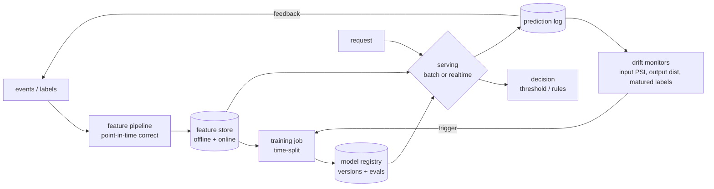

# 1 — Classical ML: Serving & Retraining Loop

*The architecture behind every 'design a fraud/forecast/churn system' question.*

## The request to walk through

'A transaction arrives' → gateway pulls features from the ONLINE store (precomputed velocity counters, merchant scores) → model scores in ~1–3ms → decision engine applies the cost-matrix threshold → decline/pass. Offline: labels mature → weekly retrain on time-split data → registry → champion/challenger rollout.

## Failure modes the boxes are hiding

- Feature pipeline: upstream schema changes (the silent killer — PSI screams, the fix is a pipeline patch, NOT a retrain)
- Online store: stale counters (late-arriving events) — grace period + late-arrival % monitored
- Serving: training/serving skew — same feature, two runtimes, slow divergence
- Drift monitors: alert fatigue — thresholds calibrated against a simulated boring month

## Tool families for each role

Feature store: Feast, Tecton, or disciplined Postgres+dbt · Training: any · Registry: MLflow, W&B · Serving: FastAPI (Lab a1's pattern) → Triton at scale · Monitoring: Evidently + Prometheus/Grafana (Lab x1).
