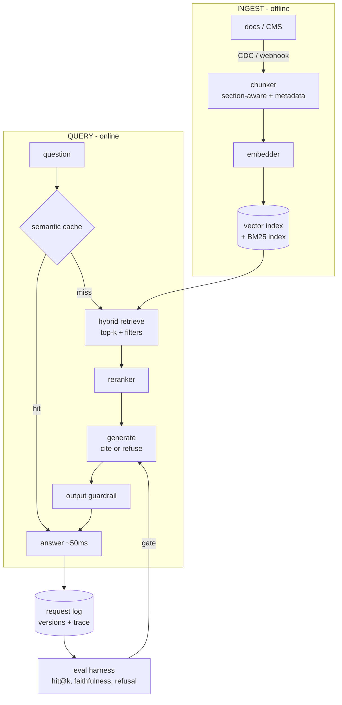

# 2 — RAG: The Full Reference Architecture

*The pipeline behind every docs-bot, support-bot, and 'chat with your data' product.*

## The request to walk through

'How do I bulk-move tasks?' → cache miss → hybrid retrieval pulls the bulk-actions article (metadata-filtered) → reranker keeps it top-3 → generation answers WITH [1] citation → guardrail passes → logged with prompt/corpus/model versions → the eval harness samples the log nightly.

## Failure modes the boxes are hiding

- Ingest: stale corpus (CDC + canary questions — the 9-days-stale failure)
- Cache: wrong hits (threshold = trust dial) and invalidation (corpus-hash keys)
- Retrieval: the three miss types (vocab → hybrid; distractors → rerank; multi-hop → decompose)
- Generation: grounding drift (cite-or-refuse prompt, measured refusal rate)
- The meta-failure: no eval harness — 'it sounds right' is how Air Canada happened (FN-04)

## Tool families for each role

Indexes: pgvector → Qdrant/Weaviate → Vespa by scale · Cache: Redis + embeddings · Reranker: cross-encoder · Eval: RAGAS-class, Langfuse/LangSmith (Lab b4's machinery). Full design: Mock 1 + capstone cap1.
