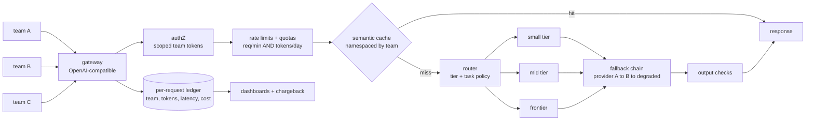

# 3 — The LLM API Gateway

*What every org with more than three teams calling LLMs ends up building (Mock 4).*

## The request to walk through

'Team B's agent asks a question' → team token authenticated → under quota → cache miss (namespaced — team A's answers never leak) → router sends the easy query to small tier → provider A is degraded → failover to provider B → output check → response; the ledger records team-B tokens for chargeback and the dashboards show the provider-B shift.

## Failure modes the boxes are hiding

- The gateway itself: SPOF — fail-open data plane (cached route tables), multi-region
- Provider failover: thundering-herd on the backup — burst-smoothing queue
- Cache: cross-team leakage without namespacing (isolation is a tested property)
- Ledgers: silent cost creep — context bloat and k-creep live in the token mix (the $14K-bill story, Q-GEN-6)

## Tool families for each role

Gateway: custom on FastAPI/Envoy, or vendor gateways · Cache: Redis+embeddings · Routing policy: config-as-code · Observability: OpenTelemetry + Langfuse-class. Full design: Mock 4.
