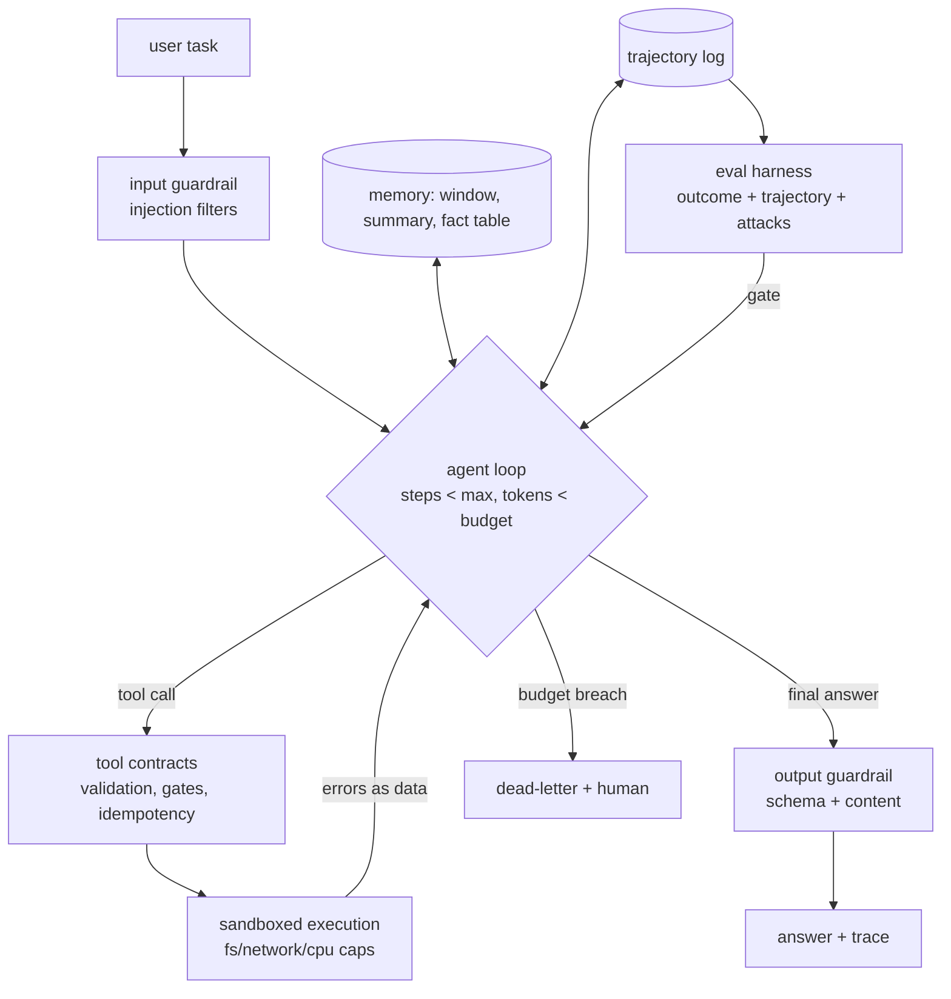

# 4 — The Agent Loop, With Guardrails

*The anatomy behind every agent product — loop, tools, budgets, and the safety stack (Labs c1, c2, c5).*

## The request to walk through

'Fix the failing test' → input guard passes → loop: model reads structured test output (failed tests + tracebacks), calls read_file (contract-validated), proposes a diff (branch-gated), runs tests in the sandbox (10s CPU cap, no network) → green → output guardrail → answer with diff evidence; the trace logs every step, and the eval gate replays it against the attack set before any tool or prompt change ships.

## Failure modes the boxes are hiding

- The loop: infinite loops and budget blowout (caps enforced OUTSIDE the model)
- Tools: hallucinated calls (contracts + errors-as-data let it self-correct)
- Memory: context bloat (three tiers; exact facts in tables, never summaries)
- Sandbox: the Chevy/Tay class — 'the sandbox is the product' (FN-03, FN-07)
- Eval: outcome-only grading misses the lucky-garbage path — trajectory grading exists for that

## Tool families for each role

Frameworks: LangGraph-class or your own ~100 lines (Lab c1) · Sandbox: containers · Traces: OpenTelemetry/LLM observability. Full design: Mock 5 + capstone cap3.
