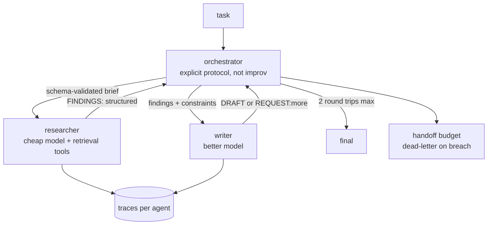

# 5 — Multi-Agent: Orchestrator + Specialists

*The architecture teams reach for too often — drawn with the controls that make it honest (Lab c3).*

## The request to walk through

'Research and write a brief on X' → orchestrator (a fixed two-step protocol, not an improvised router) → researcher (small model, retrieval tools) returns structured FINDINGS → writer (better model) drafts or REQUESTs more (one more research round, budget-capped) → final. Every handoff is a schema-validated message; every agent has its own trace.

## Failure modes the boxes are hiding

- Handoff drift: the chronic disease — one agent's format drifts, the other misroutes silently (schema validation at every hop)
- Token accounting: multi-agent cost is the SUM across agents including resent context
- The control arm: race against a monolith — teams win only on context isolation, model routing, or change isolation (measured in Lab c3)

## Tool families for each role

Orchestration: LangGraph-class, or two loops + a protocol (c3's ~20 lines). Full design: Q-AG-2 + Mock 5.
