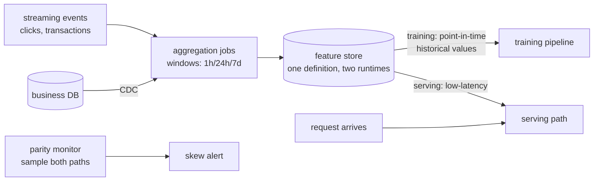

# 6 — The Feature Store, Offline & Online

*The diagram that answers every training/serving-skew question (Chapter A.1, Lab a6).*

## The request to walk through

'Transactions-per-card-per-hour' is ONE definition: the streaming job maintains it online (Redis-class, ~5ms); the batch job reconstructs it AS OF each historical moment for training (shift-correct windows); the parity monitor samples both paths and alerts on divergence before the model notices.

## Failure modes the boxes are hiding

- Point-in-time violations in training data (the leaky rolling window — Lab a6: 50–60% inflated metrics)
- Late data breaking online windows (grace period + monitored late-arrival %)
- Backfill ordering (recompute chronologically or re-introduce leakage)
- Parity drift between the two runtimes (the silent killer this diagram exists to catch)

## Tool families for each role

Stores: Feast, Tecton; or Postgres + dbt + Redis with discipline · CDC: Debezium · Aggregation: Flink/Spark. Related: diagrams 7 and ai-stack/data-pipelines.md.
