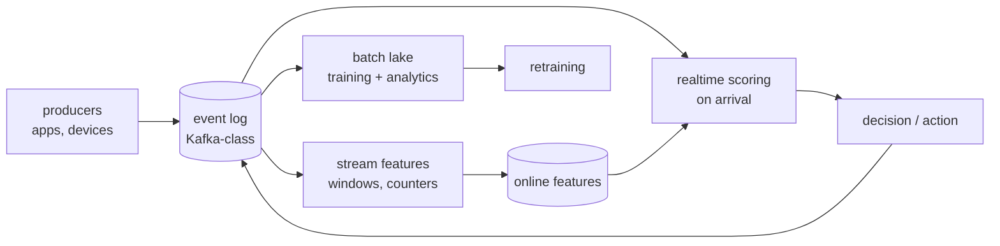

# 7 — Streaming / Event-Driven AI

*When features must be fresh in seconds and decisions happen on arrival (Chapter X.0).*

## The request to walk through

A payment event lands in the log → the stream job updates velocity counters in the online store → the scoring consumer picks up the event, pulls features (5ms), scores (2ms), decides decline/pass within the 200ms budget — while the same event flows to the lake for future training. The log is the spine: replayable, ordered, multi-consumer.

## Failure modes the boxes are hiding

- Out-of-order events corrupting windows (watermarks; late-arrival policy)
- Consumer lag under burst (the attack that's also a flash sale — same shape, different intent)
- Replay poisoning: reprocessing old events re-writes history — version the replay
- The training/serving split: stream features for serving, batch reconstruction for training (diagram 6 lives inside this one)

## Tool families for each role

Log: Kafka · Streams: Flink/Spark Streaming · Online store: Redis · Lake: parquet + warehouse. Related: diagrams 1, 6.
