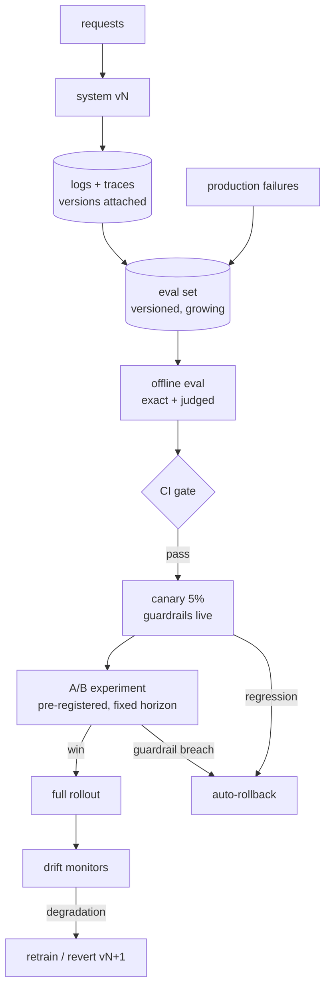

# 8 — The Evaluation & Rollout Loop

*The diagram that answers 'how do you know it works?' — the question behind every interview (X.2, Labs b4, a8).*

## The request to walk through

A prompt change is proposed → CI runs the eval set (hit@k, faithfulness, refusal — versioned with the pipeline) → gate passes → canary at 5% with guardrail metrics live → A/B confirms on the pre-registered primary → full rollout → drift monitors watch for the regression the offline eval missed → and every production failure joins the eval set, making the gate stronger each cycle.

## Failure modes the boxes are hiding

- Offline/online gap: offline metrics are a rumor — the A/B is the truth-teller (and needs power: N = 1/lift²)
- Eval set rot: stale questions pass while the product moved — grow the set from failures
- Guardrail neglect: latency and cost regressions ship because nobody pre-registered them as blockers
- The postmortem loop: failures that don't feed the eval set are lessons prepaid and unclaimed

## Tool families for each role

CI: any · Evals: RAGAS-class, promptfoo, Langfuse datasets · Experiments: in-house stats or vendor platforms · Monitors: Lab x1's horizons.
