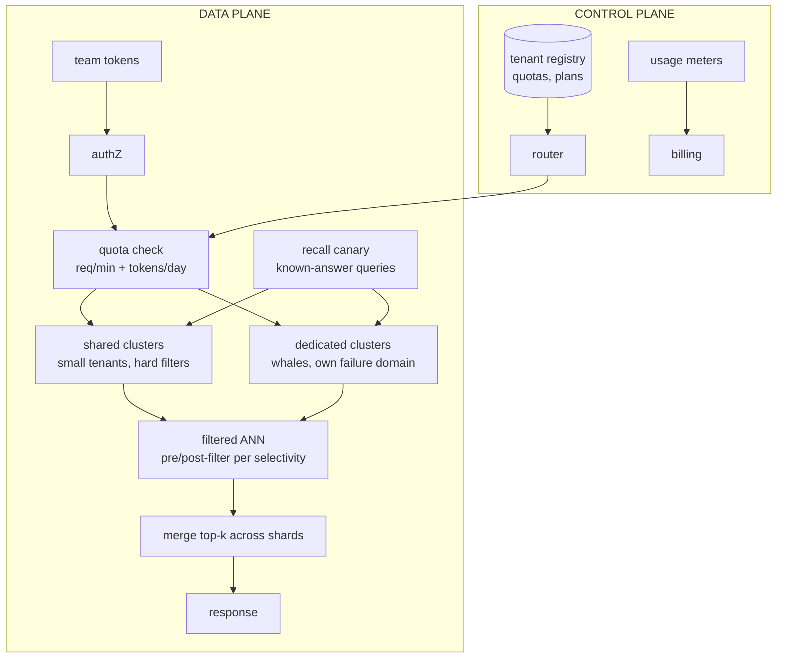

# 9 — Multi-Tenant Vector Database Service

*The platform architecture for serving embeddings at tenant scale (Mock 7, capstone cap2).*

## The request to walk through

Tenant query → token auth → quota check → router: small tenant to a shared shard (hard tenant_id filter, isolation-tested), whale to its dedicated cluster → filtered ANN (pre-filter at 0.01% selectivity, post-filter otherwise — a measured choice) → shards merge local top-k (recall drops slightly; the canary measures it continuously) → response metered for billing.

## Failure modes the boxes are hiding

- Noisy neighbor: per-tenant rate AND concurrency caps (measured: innocent p99 ×3–5 without, <10% with)
- Recall as a soft SLO: node loss degrades recall, not just capacity — the canary makes it visible
- Re-indexing the whale: blue-green index builds (hours), atomic swap, rollback kept
- Deletes: tombstone + query-time filter (correct immediately) + periodic compaction — the GDPR pattern

## Tool families for each role

Data plane: Qdrant/Milvus/Vespa/pgvector by tier · Control plane: boring CRUD · Canary: known-answer sets. Full design: Mock 7 + cap2's isolation tests.
